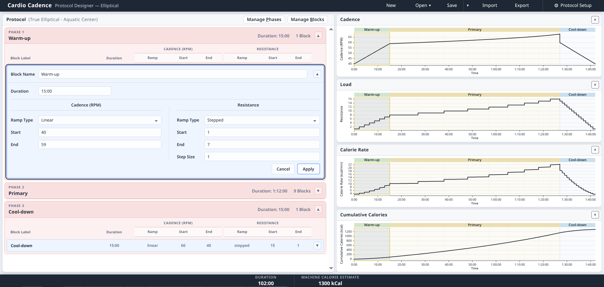
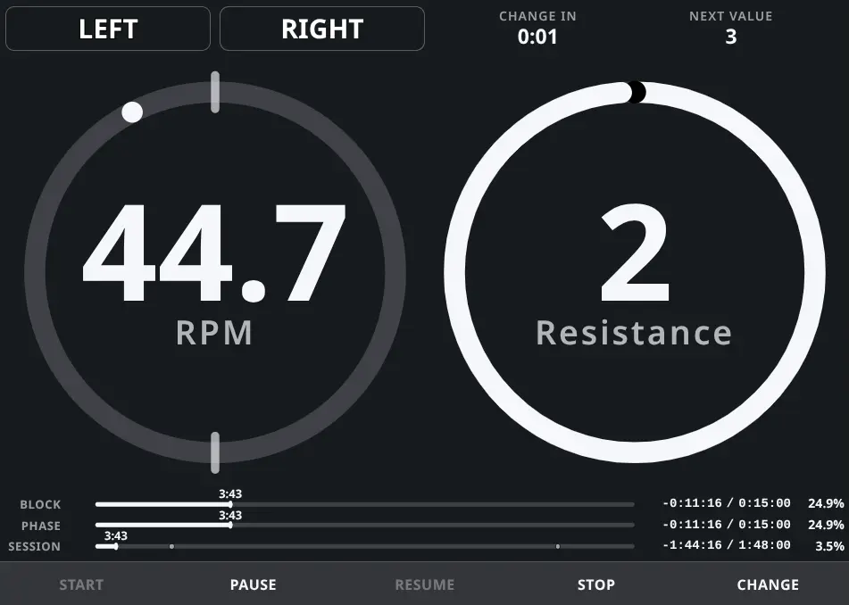
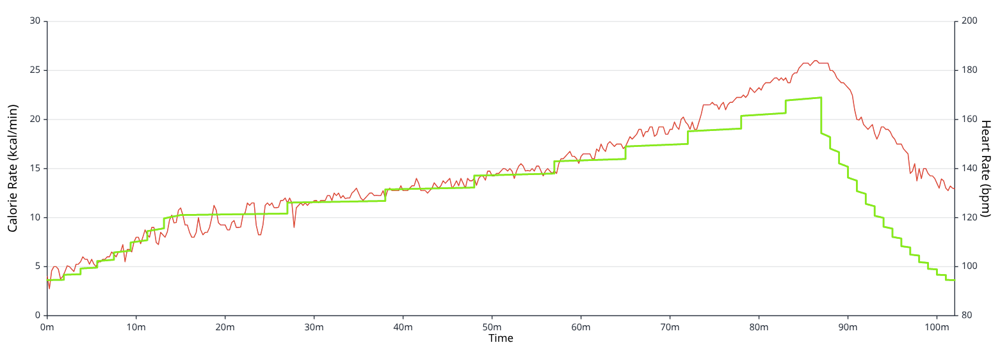

# Cardio Cadence System

A system for defining reproducible cardiovascular exercise protocols, providing precise audio and visual guidance during execution, and analyzing physiological responses to the workouts actually performed.

## Live Demo

- [Protocol Designer](https://AbidingReflection.github.io/protocol-designer/)
- [Cadence Controller](https://AbidingReflection.github.io/cadence-controller/)

The Cadence Controller is also installable as a Progressive Web App.

## Motivation

Structured cardio workouts can demand mental attention alongside physical effort. When a session calls for precise changes in cadence or load (such as resistance or incline), keeping track of what to adjust and when can disrupt concentration and exercise rhythm.

Heart rate data can provide insight into the body's response to exercise, but becomes more informative when examined alongside the workout plan. Aligning these measurements with prescribed targets and a record of how the session actually unfolded makes it possible to examine cardiovascular responses to specific stages of a workout and compare them when the same protocol is repeated.

**Cardio Cadence System** aims to bring these pieces together by connecting structured workout planning, guided execution through timed visual instructions and activity-specific audio cadence cues, and performance analysis informed by the workout plan and session record. The system is designed to support different cardiovascular activities and exercise equipment through a common framework.

## System Overview

Cardio Cadence System follows a central workflow:

**Design → Execute → Analyze**

At the center of this workflow is the **workout protocol**, a structured, time-based definition of the intended exercise. The protocol provides a common reference for guiding execution, recording what actually occurred, and interpreting the resulting physiological response.

### Protocol Designer



The Protocol Designer provides an interface for creating and managing structured workout protocols. Workouts are organized into phases and blocks, each defining a duration and prescribed targets such as cadence, resistance, or incline. Configurable progression patterns determine how these targets change over time.

Interactive graphs visualize the planned workout, while activity types, machine profiles, and calibration data provide equipment-specific context for validation and estimated energy expenditure. Protocols can be saved, modified, and reused across sessions.

### Cadence Controller



The Cadence Controller translates a workout protocol into real-time execution guidance. It tracks workout progression, displays current targets and upcoming transitions, and provides visual timing and progress indicators throughout the session.

The controller also records execution events, including pauses, navigation, and deviations from the planned workout. These events preserve the distinction between the prescribed protocol and the session actually performed.

Audio cadence guidance supports consistent movement rhythm, with broader activity-specific cue functionality planned for future development.

### Workout Analyzer — In Development



The Workout Analyzer is intended to connect workout protocols, recorded execution, and physiological measurements to provide a more complete understanding of cardiovascular responses to exercise.

The current prototype visualizes recorded heart-rate data alongside protocol-derived estimates of energy expenditure, providing an initial view of physiological response in the context of a planned workout.

Further development will incorporate execution records and comparisons across sessions, helping identify patterns in physiological responses and inform adjustments to future workout protocols.


## Project Status

Cardio Cadence System is an ongoing personal development project.

The Protocol Designer and Cadence Controller are functional applications available through the live demonstrations above. The Workout Analyzer has an initial working prototype, with integration of execution records and cross-session analysis still under development.

Development continues toward the broader goal of connecting workout design, guided execution, and physiological analysis into a complete system.

## Development Approach

Cardio Cadence System is an independently developed personal project that has grown from a practical idea into a much broader exploration of software design and development. Much of the work has involved thinking through the underlying problems, defining how the pieces should fit together, and refining those decisions as the system takes shape.

Development has followed an incremental, test-first approach, with an emphasis on well-defined responsibilities, modular components, and predictable behavior. Establishing expected behavior through automated tests has made it possible to develop components independently, identify problems early, and confidently integrate and refactor functionality as the project grows.

The process has been as much about discovery as implementation. Beyond building a working application, the goal has been to develop a cohesive system whose behavior can be understood, verified, and trusted.

## Documentation

A separate technical overview is planned to provide a more detailed examination of the system's architecture, protocol model, execution logic, data management, and analytical methods.

## Running Locally

The applications are browser-based and can be served locally without installing a separate application framework.

From the repository root:

```bash
./scripts/build-pages.sh
cd publish
python3 -m http.server 9000
```

The applications are then accessible at:

- **Protocol Designer:** http://localhost:9000/protocol-designer/
- **Cadence Controller:** http://localhost:9000/cadence-controller/

## License

Copyright remains with the original developer.

This project is made available under the **PolyForm Noncommercial License 1.0.0**, permitting noncommercial use, modification, and distribution under the terms of the license. Commercial use requires separate permission from the copyright holder.

See [LICENSE](LICENSE) for the complete license terms.
